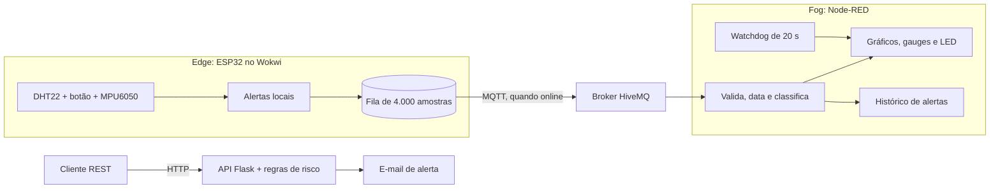
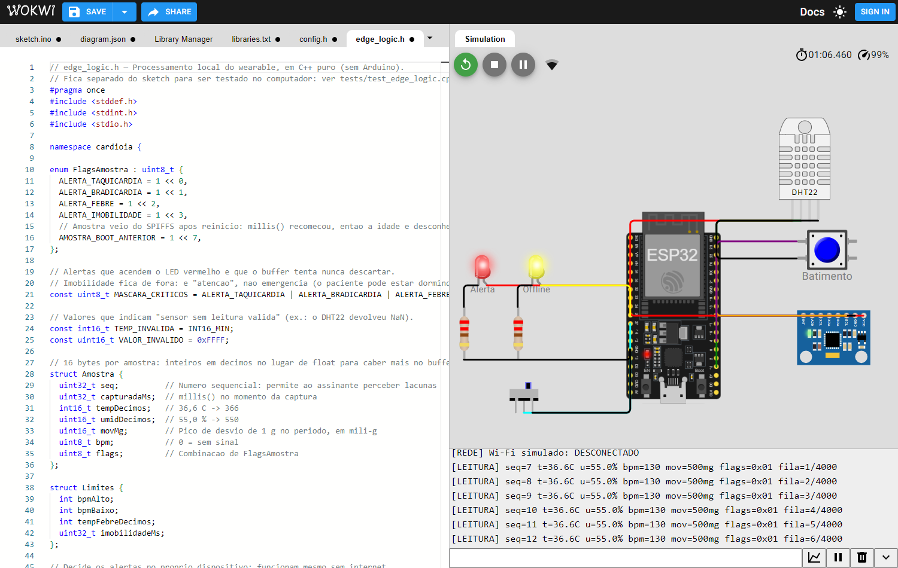
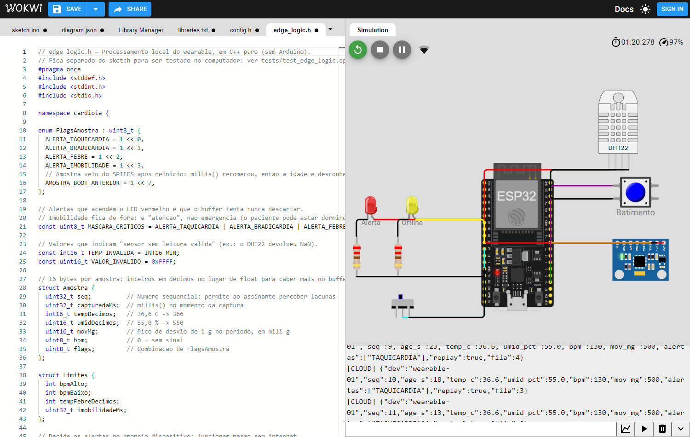
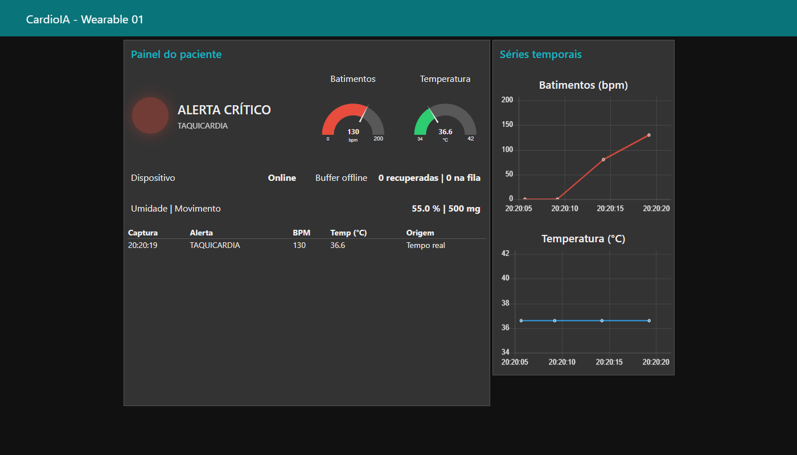
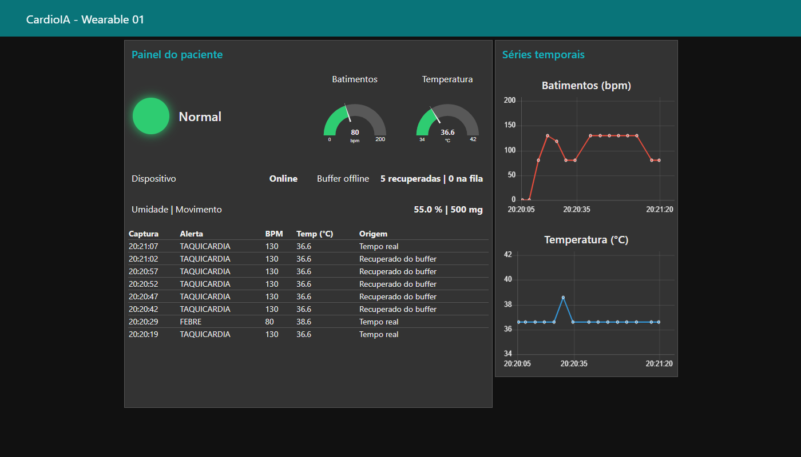
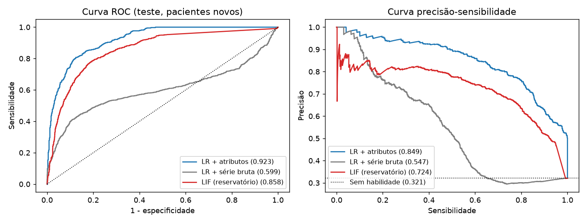

# FIAP - Faculdade de Informática e Administração Paulista

<p align="center">
<a href="https://www.fiap.com.br/"></a>
</p>

<br>

# 🎓 Graduação ON em Inteligência Artificial

## 📚 Repositório Oficial de Projetos e Trabalhos Acadêmicos

### ❤️ CardioIA Conectada — Fase 3: Monitoramento Contínuo (IoT no Peito do Paciente)

---

## 👨‍🎓 Integrantes

**Grupo Zion**

| Nome | RM | LinkedIn |
|------|-----|----------|
| Cesar Martinho de Azeredo | RM568140 | [](https://www.linkedin.com/in/cesar-azeredo) |
| Carlos Alberto Florindo Costato | RM567005 | [](https://www.linkedin.com/in/carlos-costato/) |
| Phellype Matheus Giacoia Flaibam Massarente | RM566826 | [](https://www.linkedin.com/in/phellype-massarente-13739810a/) |

## 👨‍🏫 Professores

- **Tutor**: Andre Godoy
- **Coordenadora**: Ana Cristina dos Santos

---

## 👩🏻‍💻 Sobre este Repositório

Doenças cardiovasculares causam cerca de 17,9 milhões de mortes por ano, e boa parte das crises dá sinais antes de acontecer. Esta fase do **CardioIA** simula um wearable que acompanha o paciente fora do hospital e percorre o fluxo completo de dados em IoT: **captura → processamento → transmissão → visualização → alerta**.

- **Edge (ESP32):** lê os sensores, decide os alertas no próprio dispositivo e guarda até 4.000 amostras (5h33min) quando fica sem conexão.
- **Fog (Node-RED):** reavalia os limites, recoloca os dados recuperados no horário certo e avisa quando as leituras param de chegar.
- **Cloud (HiveMQ):** transporta a telemetria por MQTT.
- **Ir Além 1:** API REST em Python com lógica de risco e e-mail automático.
- **Ir Além 2:** regressão logística × rede neuromórfica LIF em batimentos reais do MIT-BIH.

> ⚠️ Projeto acadêmico, com dados simulados ou públicos anonimizados. Nada aqui serve para decisão clínica.

### Mapa mental da jornada

Esta entrega corresponde à **Fase 3** das 7 fases do CardioIA: [ver mapa mental](assets/mapa-mental/imagem-mapa-mental.png).

---

## 🔗 Links da Entrega

| Entregável | Link |
|---|---|
| Projeto no Wokwi | https://wokwi.com/projects/479712047921435649 |
| Vídeo do Ir Além 2 (YouTube, não listado) | https://www.youtube.com/watch?v=HavGiwZKTMc |
| Fase 1 do CardioIA | https://github.com/Cesar-Azeredo/CardioAI |

---

## 🎯 Objetivo e Entregáveis

| Parte | O que foi feito | Onde está | Relatório |
|---|---|---|---|
| **1. Edge Computing** | ESP32 com DHT22, botão de batimentos e MPU6050; fila resiliente offline | [firmware/sketch](firmware/sketch) | [Parte 1](docs/RELATORIO_PARTE_1.md) |
| **2. Fog/Cloud** | MQTT no HiveMQ e dashboard Node-RED com gráficos, gauges e LED de alerta | [dashboard/node-red](dashboard/node-red) | [Parte 2](docs/RELATORIO_PARTE_2.md) |
| **Ir Além 1** | API REST, cliente Python, regras de risco e e-mail | [services](services) | [Ir Além 1](docs/RELATORIO_IR_ALEM_1.md) |
| **Ir Além 2** | Notebook comparando regressão logística e LIF | [notebooks](notebooks/ir_alem_2_series_temporais.ipynb) | [Ir Além 2](docs/RELATORIO_IR_ALEM_2.md) |

Critério a critério: [docs/BAREMA_CHECKLIST.md](docs/BAREMA_CHECKLIST.md).

---

## 🧠 Estrutura Macro do Repositório

```bash
📂 CardioIA_Conectada
│
├── 📂 firmware/sketch           # ESP32: abre no Wokwi, Arduino IDE e PlatformIO
│   ├── sketch.ino               # Sensores, conectividade e MQTT
│   ├── edge_logic.h             # Alertas, BPM, fila e JSON (C++ puro, testável)
│   ├── config.h                 # Pinos, limites clínicos, capacidade e rede
│   └── diagram.json             # Circuito do Wokwi
│
├── 📂 dashboard/node-red        # flows.json (dashboard) e dependências
├── 📂 services                  # Ir Além 1: API REST, cliente, risco e e-mail
├── 📂 notebooks                 # Ir Além 2: séries temporais
├── 📂 scripts                   # Simulador MQTT e captura de evidências
├── 📂 tests                     # Testes da lógica de borda e da API
├── 📂 docs                      # Relatórios, barema e roteiro de vídeo
├── 📂 assets/evidencias         # Prints e saídas reais
│
├── requirements.txt
├── .env.example
└── README.md
```

---

## 🏗️ Arquitetura



### Limites clínicos definidos pelo grupo

| Alerta | Regra | Nível |
|---|---|---|
| Taquicardia | BPM > 120 | Crítico |
| Bradicardia | 0 < BPM < 50 | Crítico |
| Febre | Temperatura > 38,0 °C | Crítico |
| Imobilidade | Sem movimento por 2 min (valor de demonstração) | Atenção |

Os limites estão no firmware, no Node-RED e na API; um [teste automatizado](tests/test_ir_alem_1.py) falha se divergirem.

---

## ⚙️ Setup Rápido

### Parte 1: ESP32

Abra o [projeto no Wokwi](https://wokwi.com/projects/479712047921435649) e clique em ▶. Com o dashboard aberto, teste:

| Ação | Efeito |
|---|---|
| Apertar o botão azul em ritmo constante | Gera o BPM |
| Enviar `b130` no Monitor Serial | Simula 130 bpm sem apertar o botão (`b0` desliga) |
| Clicar no DHT22 e subir a temperatura | Testa a febre |
| Mover o switch para a direita | Fica offline; LED amarelo acende e a fila cresce |
| Mover o switch para a esquerda | Volta online e sincroniza a fila |
| Enviar `s` no Monitor Serial | Mostra o status |

### Parte 2: Dashboard

```bash
cd dashboard/node-red
npm install
npm start
# Abra http://localhost:1880/ui
```

Para ver o painel reagir sem abrir o Wokwi, publique o roteiro de teste com o simulador:

```bash
python -m venv .venv
.venv\Scripts\activate          # Linux/macOS: source .venv/bin/activate
pip install -r requirements.txt
python scripts/simula_esp32.py
```

### Ir Além 1: API REST e e-mail

```bash
python -m services.api_rest      # Em um terminal
python -m services.cliente_rest  # Em outro terminal
```

Sem SMTP configurado, os e-mails são gravados como `.eml` em `data/runtime/emails/`. Para enviar de verdade, defina as variáveis de [.env.example](.env.example).

### Ir Além 2: Notebook

Abra [notebooks/ir_alem_2_series_temporais.ipynb](notebooks/ir_alem_2_series_temporais.ipynb) no Jupyter ou no Colab. Execução completa: cerca de 2 minutos, com internet para baixar as anotações da PhysioNet.

### Testes

```bash
pytest tests

# Lógica de borda, com qualquer compilador C++17:
g++ -std=c++17 tests/test_edge_logic.cpp -o test_edge && ./test_edge
```

---

## 📌 Status do Projeto

- ✅ Firmware executado no Wokwi real: sensores, alertas, queda de conexão e MQTT, com roteiro automatizado em [scripts/teste_wokwi.py](scripts/teste_wokwi.py). [Monitor Serial da execução](assets/evidencias/wokwi_monitor_serial.txt).
- ✅ Firmware compila também para chip real com SPIFFS e HiveMQ Cloud com TLS (PlatformIO).
- ✅ Lógica de borda testada no computador: alertas, BPM, fila e JSON.
- ✅ Dashboard testado de ponta a ponta: ESP32 no Wokwi → broker público HiveMQ → Node-RED.
- ✅ API REST testada com HTTP e SMTP reais em ambiente local (24 testes).
- ✅ Notebook executado por inteiro com dados reais.
- ⏳ SPIFFS e TLS foram apenas compilados: não houve chip real nem cluster HiveMQ Cloud.
- ⏳ Vídeo do Ir Além 2 a gravar.
- ➖ Grafana (opcional) não foi usado.

---

## 📸 Evidências

Os prints abaixo vêm de uma execução real: **ESP32 simulado no Wokwi, publicando no broker público da HiveMQ, com o Node-RED assinando.** Galeria completa em [assets/evidencias/README.md](assets/evidencias/README.md).

#### Wokwi: sem conexão, o alerta segue ativo e a fila cresce


#### Wokwi: a conexão volta e a fila é enviada com `"replay":true`


#### Dashboard: alerta crítico vindo do ESP32


#### Dashboard: dados recuperados no horário original


#### Ir Além 2: LR × LIF em pacientes fora do treino


---

## 📚 Documentação Auxiliar

- 📝 Relatórios: [Parte 1](docs/RELATORIO_PARTE_1.md) · [Parte 2](docs/RELATORIO_PARTE_2.md) · [Ir Além 1](docs/RELATORIO_IR_ALEM_1.md) · [Ir Além 2](docs/RELATORIO_IR_ALEM_2.md)
- 📋 Checklist de barema: [docs/BAREMA_CHECKLIST.md](docs/BAREMA_CHECKLIST.md)
- 🧾 Evidências e passo a passo do Wokwi: [docs/EVIDENCIAS_ENTREGA.md](docs/EVIDENCIAS_ENTREGA.md)
- 🎥 Roteiro de vídeo: [docs/VIDEO_SCRIPT_4MIN.md](docs/VIDEO_SCRIPT_4MIN.md)

---

## 📋 Licença


<p xmlns:cc="http://creativecommons.org/ns#" xmlns:dct="http://purl.org/dc/terms/"><a property="dct:title" rel="cc:attributionURL" href="https://github.com/Phemassa/CardioIA_Conectada">CardioIA Conectada</a> por <a rel="cc:attributionURL dct:creator" property="cc:attributionName" href="https://fiap.com.br">FIAP</a> está licenciado sobre <a href="http://creativecommons.org/licenses/by/4.0/?ref=chooser-v1" target="_blank" rel="license noopener noreferrer" style="display:inline-block;">Attribution 4.0 International</a>.</p>
