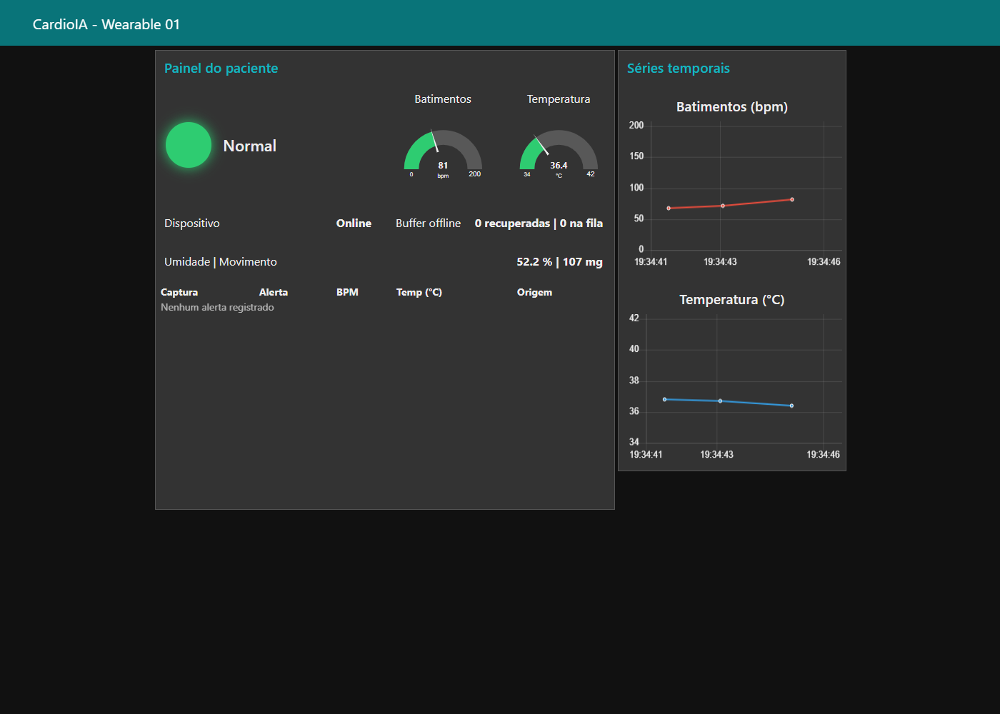
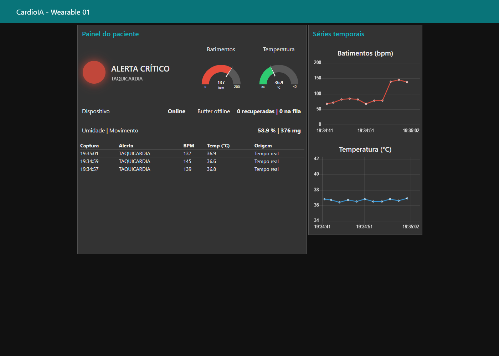
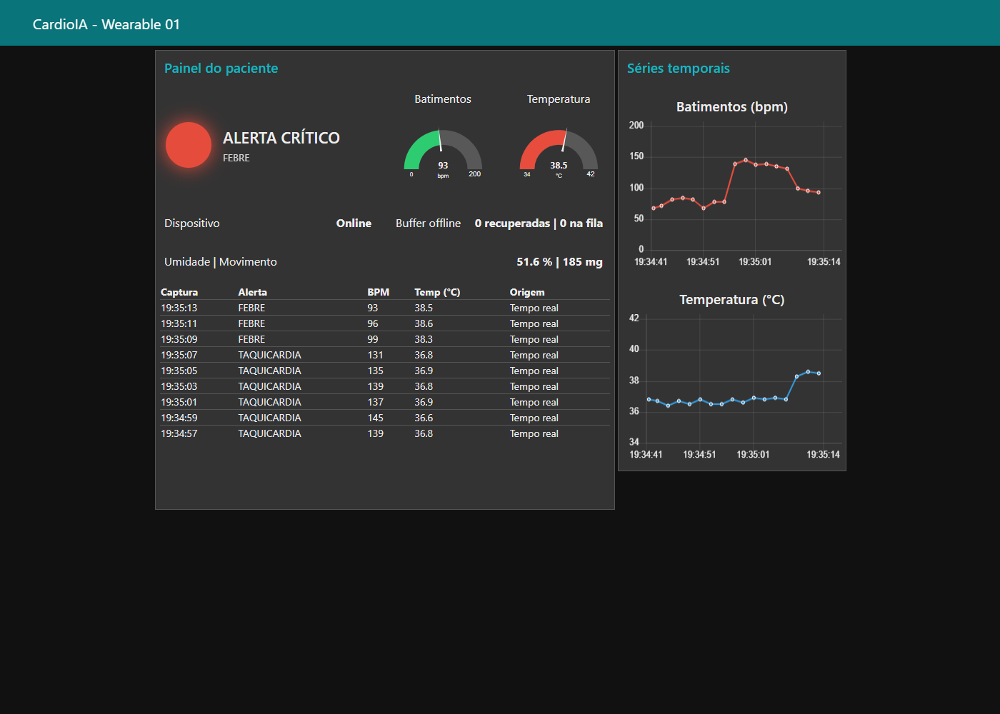
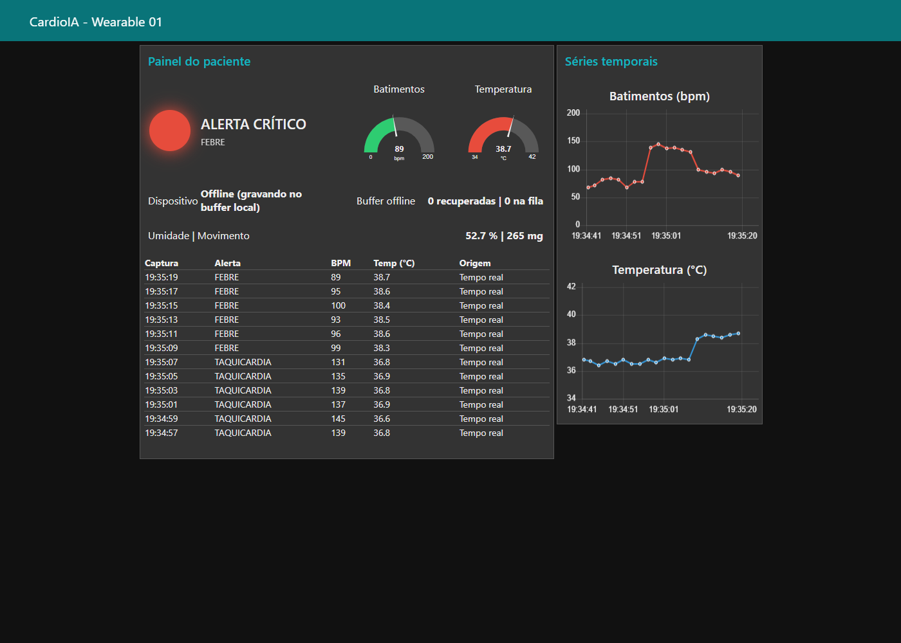
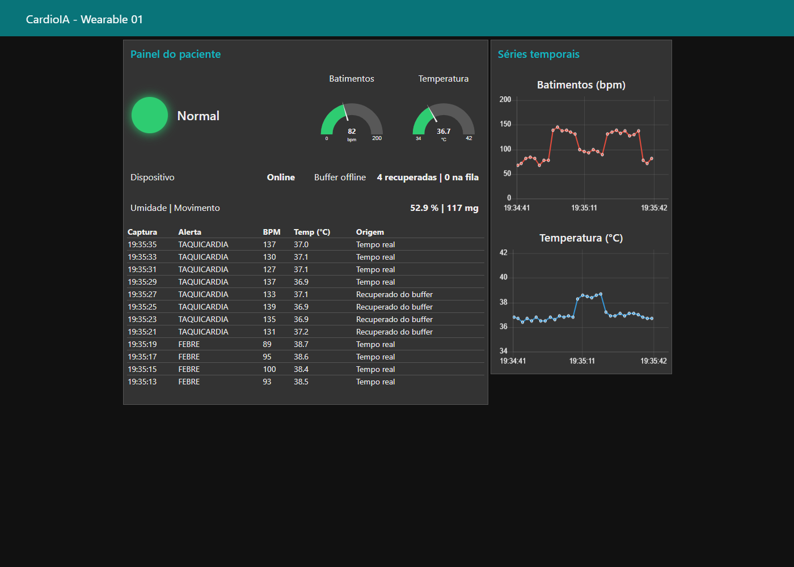
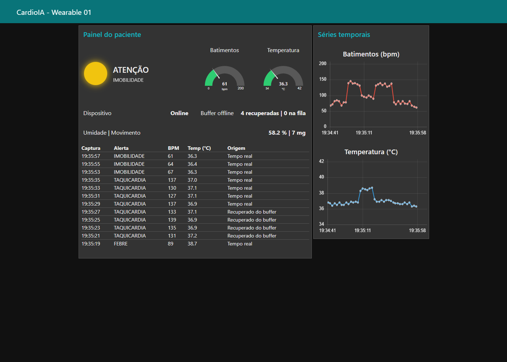
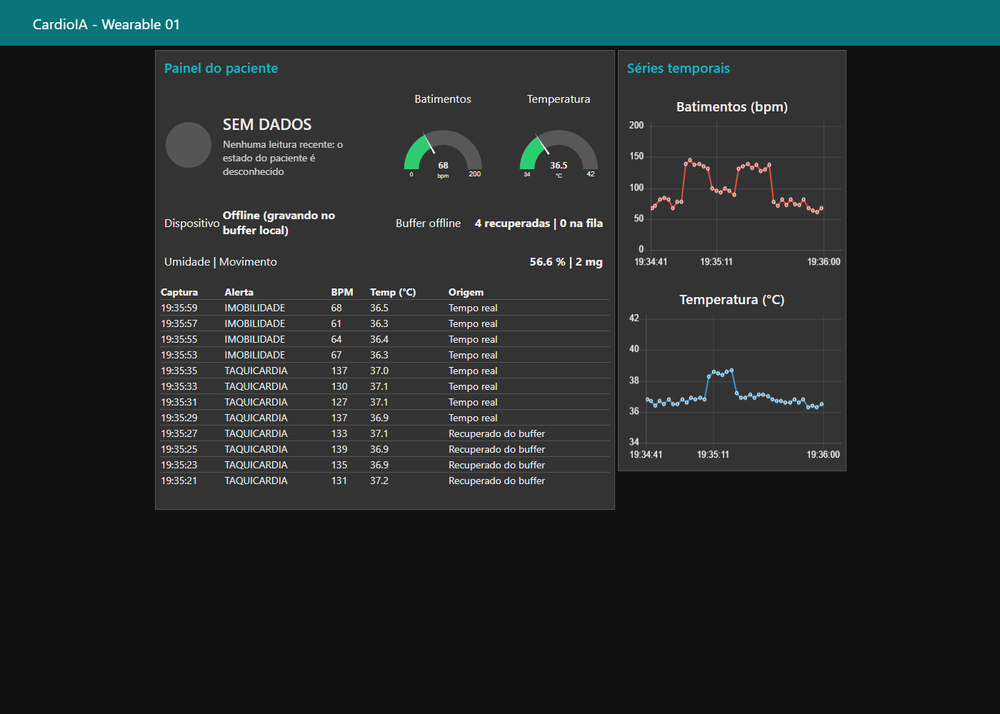
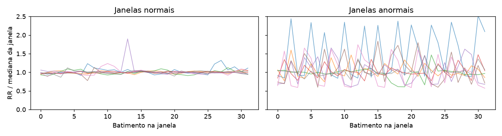
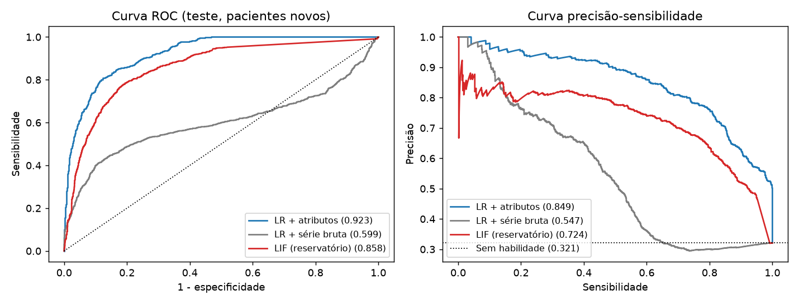
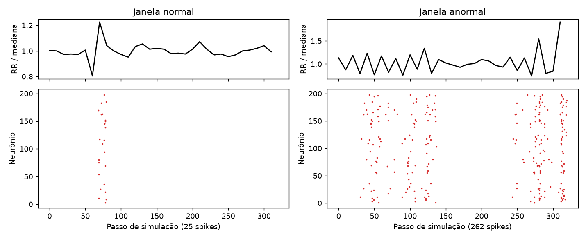

# Galeria de Evidências

**Origem:** os prints do dashboard foram gerados por `scripts/capture_evidencias.py`, com o Node-RED real ligado ao broker público da HiveMQ. Os dados vêm do **simulador Python** (`scripts/simula_esp32.py`), que publica o mesmo JSON do firmware, e não do ESP32. Os prints do Wokwi estão pendentes: ver [docs/EVIDENCIAS_ENTREGA.md](../../docs/EVIDENCIAS_ENTREGA.md).

## Parte 2: Dashboard

### Sinais normais

### Taquicardia

### Febre

### Dispositivo offline

### Reconexão: dados recuperados no horário original

### Imobilidade (nível de atenção)

### Sem leituras: o painel avisa em vez de congelar

## Ir Além 1: API REST e e-mail

- [Saída do cliente REST](ir_alem_1_execucao.txt)
- [E-mail de alerta gerado](ir_alem_1_email_exemplo.eml)

## Ir Além 2: Séries temporais

### Janelas normais e anormais

### Curvas em pacientes fora do treino

### Atividade da rede LIF

