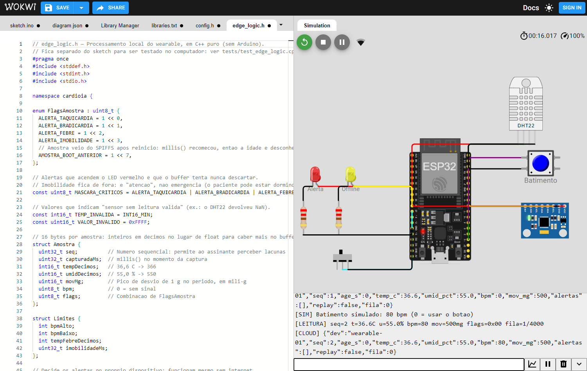
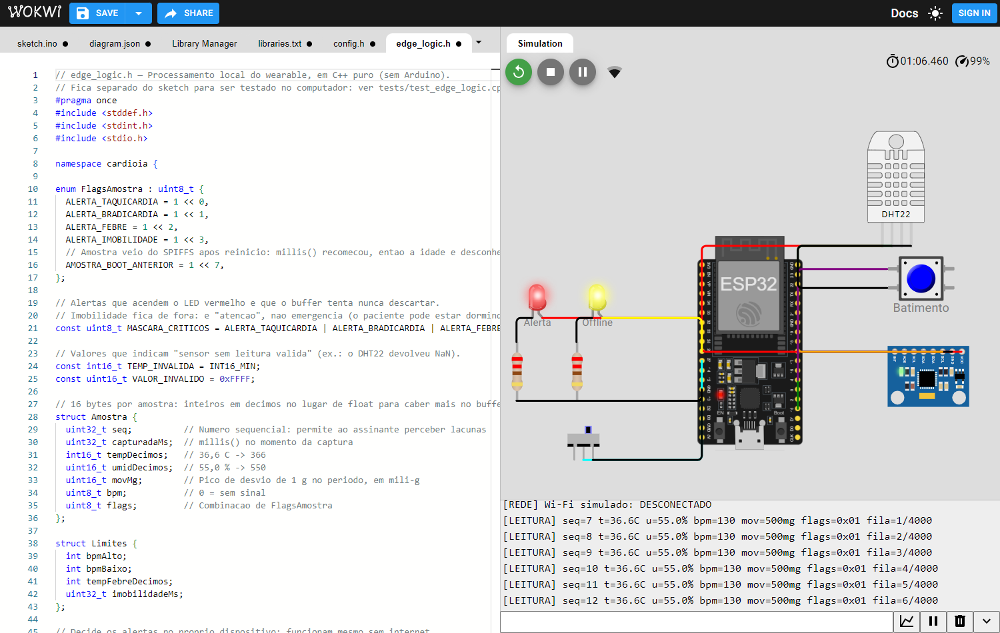
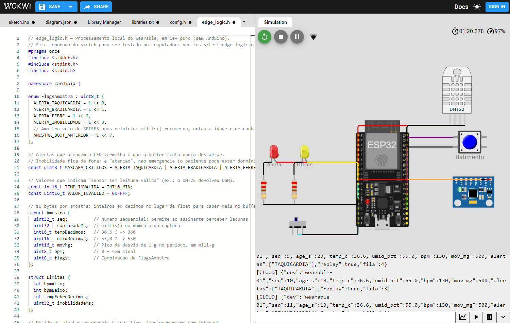
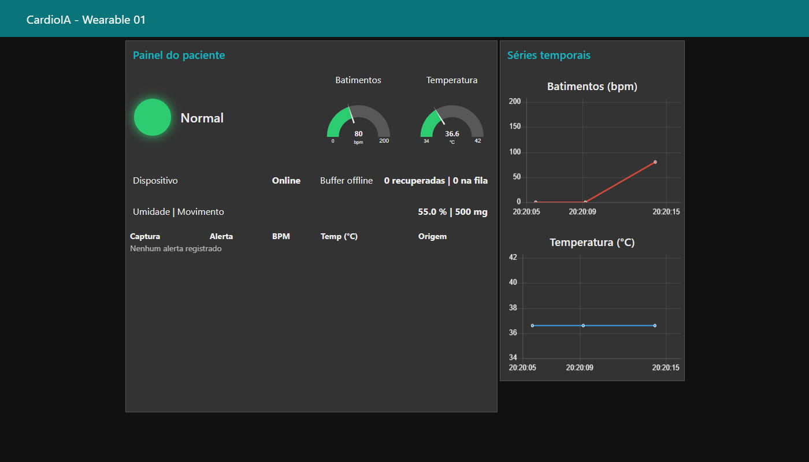
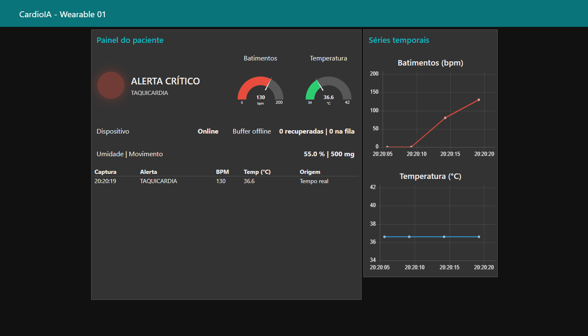
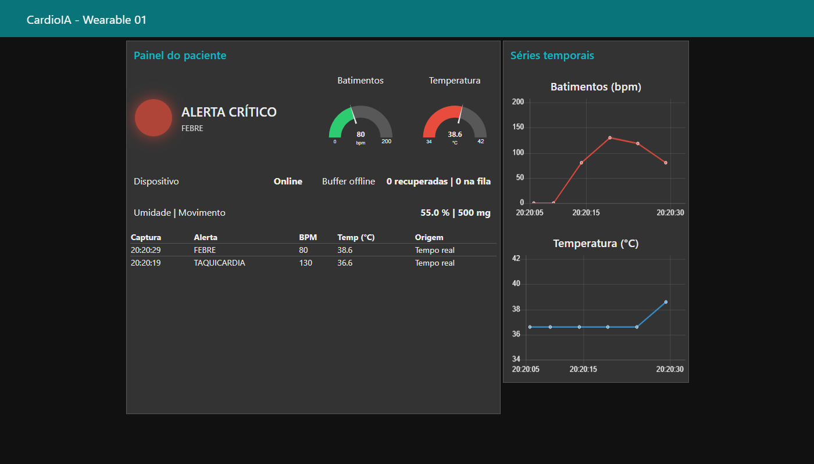
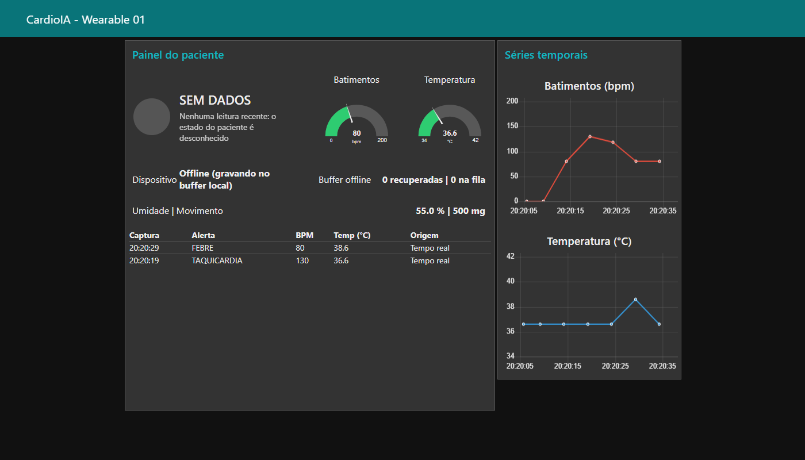
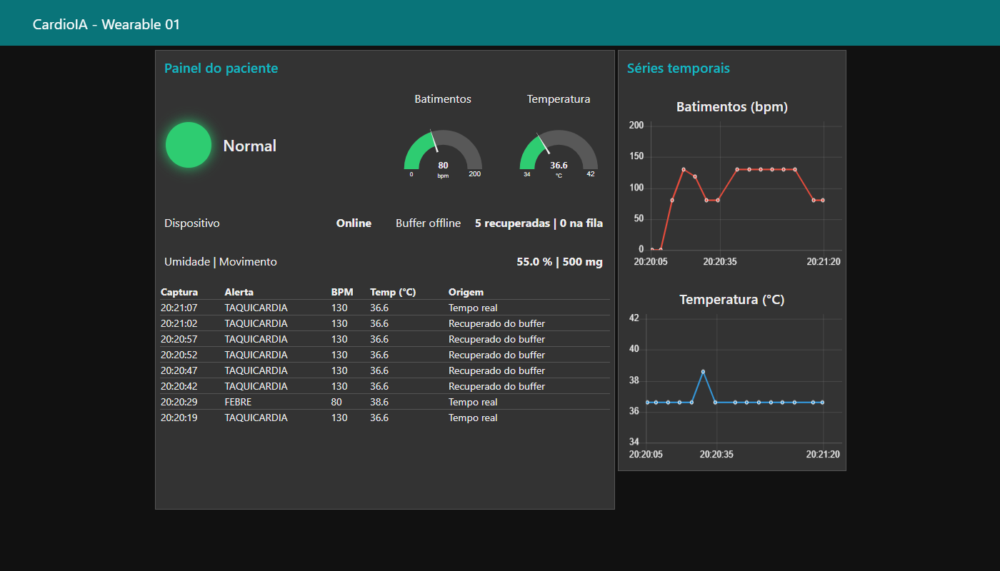
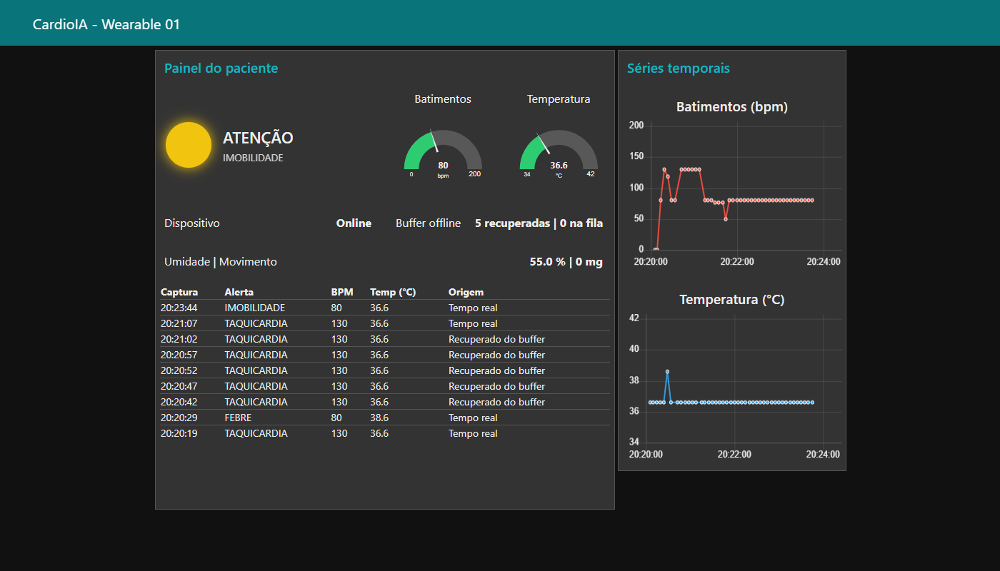

# Galeria de Evidências

## Parte 1: ESP32 no Wokwi

Gerados por `scripts/teste_wokwi.py`. Registro completo: [Monitor Serial](wokwi_monitor_serial.txt).

### Circuito em execução, online

### Taquicardia: LED vermelho aceso

### Sem conexão: LEDs acesos e fila crescendo

### Conexão de volta: fila enviada com `"replay":true`

## Parte 2: Dashboard recebendo o ESP32 do Wokwi

### Sinais normais

### Taquicardia

### Febre

### Dispositivo offline

### Reconexão: dados recuperados no horário original

### Imobilidade (nível de atenção)

## Parte 2: Dashboard recebendo o simulador Python

Gerados por `scripts/capture_evidencias.py`. Os dados vêm de `scripts/simula_esp32.py`, que publica o mesmo JSON do firmware, e não do ESP32.

### Sinais normais

### Taquicardia

### Febre

### Dispositivo offline

### Reconexão: dados recuperados no horário original

### Imobilidade (nível de atenção)

### Sem leituras: o painel avisa em vez de congelar

## Ir Além 1: API REST e e-mail

- [Saída do cliente REST](ir_alem_1_execucao.txt)
- [E-mail de alerta gerado](ir_alem_1_email_exemplo.eml)

## Ir Além 2: Séries temporais

### Janelas normais e anormais

### Curvas em pacientes fora do treino

### Atividade da rede LIF

