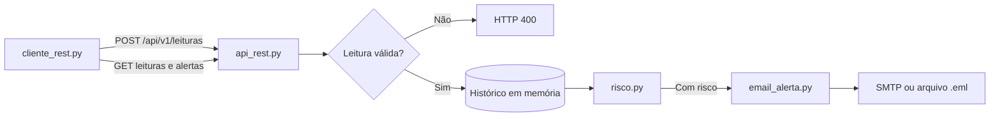

# Relatório do Ir Além 1: Comunicação Automatizada com REST e E-mail

**CardioIA Conectada, Grupo Zion**

## 1. O que foi construído

Um cliente Python envia sinais vitais por HTTP a uma API REST. A API guarda cada leitura, avalia o risco e, em caso de alerta, dispara um e-mail sem intervenção humana: a automação (RPA) que substitui alguém vigiando números em uma tela.

| Arquivo | Responsabilidade |
|---|---|
| [services/api_rest.py](../services/api_rest.py) | Rotas Flask, validação e histórico |
| [services/cliente_rest.py](../services/cliente_rest.py) | Envio e consulta com `requests`; cenário de teste |
| [services/risco.py](../services/risco.py) | Regras de risco, sem rede nem banco |
| [services/email_alerta.py](../services/email_alerta.py) | Monta e dispara o e-mail |

## 2. API REST

| Método e rota | Função | Respostas |
|---|---|---|
| `POST /api/v1/leituras` | Registra a leitura e devolve os riscos | 201 ou 400 |
| `GET /api/v1/leituras?dispositivo=&limite=` | Consulta as leituras | 200 ou 400 |
| `GET /api/v1/alertas?dispositivo=&limite=` | Consulta as leituras com alerta | 200 ou 400 |
| `GET /api/v1/saude` | Indica o estado e o modo de e-mail | 200 |

A validação recusa tipos errados e valores impossíveis, como 300 bpm: isso é falha de sensor ou de envio, não sinal clínico. Um campo ausente é aceito e fica como `null`, pois um sensor com defeito não deve impedir o registro dos demais.

## 3. Lógica de risco

| Risco | Regra | Nível |
|---|---|---|
| Taquicardia | BPM > 120 | Crítico |
| Bradicardia | 0 < BPM < 50 | Crítico |
| Febre | Temperatura > 38,0 °C | Crítico |
| Ausência de movimento | 24 leituras seguidas abaixo de 50 mg | Atenção |

As regras são os mesmos limites do firmware e do Node-RED, e um teste falha se divergirem. Cada risco traz uma explicação legível, como "137 bpm, acima do limite de 120 bpm": em saúde, quem recebe um alerta precisa saber por que ele existe. A ausência de movimento exige a janela inteira porque uma leitura parada isolada não significa nada, e uma lacuna do sensor não conta como imobilidade.

## 4. Automação do e-mail

Sem `SMTP_HOST`, o sistema **simula** o disparo, gravando um `.eml` real que abre em qualquer cliente de e-mail ([exemplo](../assets/evidencias/ir_alem_1_email_exemplo.eml)). Com `SMTP_HOST` e as demais variáveis de [.env.example](../.env.example), ele envia de verdade.

Três decisões evitam problemas comuns em automação de alertas:

- **Pausa de 5 minutos por tipo de risco:** durante uma crise, o risco aparece em toda leitura. Sem pausa, a equipe receberia um e-mail a cada 5 s e passaria a ignorá-los, a chamada fadiga de alarme. A pausa é por tipo: uma febre nova em plena taquicardia ainda avisa.
- **Falha de e-mail não perde o dado:** a leitura é salva antes do envio. Se o SMTP cair, a API responde 201 e informa o erro, e a pausa não é consumida, então a leitura seguinte tenta de novo.
- **Assunto sem dados clínicos:** assuntos aparecem em telas bloqueadas, por isso trazem só o pseudônimo e o tipo de alerta. Os valores ficam no corpo.

## 5. Como foi verificado

Foram 24 testes automatizados ([tests/test_ir_alem_1.py](../tests/test_ir_alem_1.py)), todos passando. O mais importante roda sem simular a infraestrutura: o cliente fala por HTTP com a API em um servidor real, e a API entrega por SMTP a um servidor de e-mail local.

A execução pela linha de comando está registrada em [ir_alem_1_execucao.txt](../assets/evidencias/ir_alem_1_execucao.txt). De 35 leituras enviadas, 7 geraram alerta, resultando em 3 e-mails: taquicardia, febre e imobilidade. As repetições foram seguradas pela pausa, e as 5 leituras normais iniciais não alarmaram.

**Não testado:** envio por um provedor externo, como Gmail, nem STARTTLS com autenticação, porque o teste usa um servidor local simples.

## 6. Limitações

- O histórico fica em memória e se perde ao reiniciar a API; um produto real usaria um banco de dados.
- A API não tem autenticação nem HTTPS. Para o uso local desta demonstração, ela escuta só em `127.0.0.1`.
- A pausa entre e-mails também é perdida ao reiniciar a API.
- O e-mail não confirma leitura. Um sistema real precisaria escalar para outro canal se ninguém responder.
- Os limites são escolhas do grupo, sem validação clínica, e não consideram idade ou histórico do paciente.
