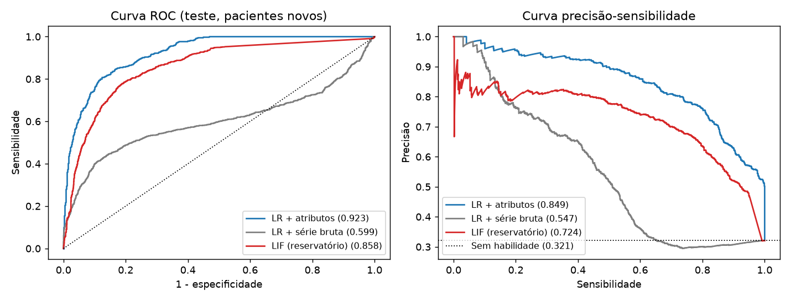
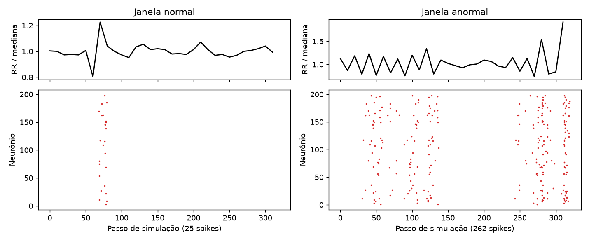

# Relatório do Ir Além 2: Regressão Logística × Rede Neuromórfica em Séries de Batimentos

**CardioIA Conectada, Grupo Zion**

Código e resultados: [notebooks/ir_alem_2_series_temporais.ipynb](../notebooks/ir_alem_2_series_temporais.ipynb).

## 1. Resumo

Comparamos três modelos na tarefa de detectar trechos com arritmia usando apenas os intervalos entre batimentos. Em pacientes fora do treino, **a regressão logística com atributos clínicos superou o reservatório de neurônios LIF** (AUC-PR de 0,849 contra 0,724; diferença de +0,123, IC95% de +0,044 a +0,222). O LIF não exigiu engenharia de atributos e dispara mais em janelas anormais, mas custou cerca de 640 vezes mais operações em nossa simulação, que não reflete o custo em um chip neuromórfico. Para este problema e estes dados, o modelo simples foi a melhor escolha.

## 2. Dados e tarefa

Usamos a **MIT-BIH Arrhythmia Database** (PhysioNet, licença Open Data Commons Attribution v1.0), com batimentos anotados por cardiologistas. O sinal de entrada é o intervalo RR, o mesmo tipo de informação que o wearable da Fase 3 produz.

Cada exemplo é uma janela de 32 batimentos, com passo de 16. A janela é **anormal** se ao menos 10% dos batimentos forem ectópicos (classes S, V ou F da norma AAMI). Esse rótulo é uma definição nossa, não um diagnóstico.

| Conjunto | Registros | Janelas | % anormais |
|---|---|---|---|
| Treino (DS1) | 22 | 3.155 | 24,5% |
| Teste (DS2) | 21 | 2.943 | 32,1% |

**Separação por paciente.** Sortear janelas ao acaso colocaria a mesma pessoa no treino e no teste e inflaria as métricas. Partimos da divisão DS1/DS2 de De Chazal et al. (2004), que também exclui os quatro registros com marca-passo. Encontramos um detalhe a corrigir: a documentação do MIT-BIH informa que os registros 201 e 202 são do mesmo paciente, e a divisão original deixa um em cada lado. Retiramos o 202 do teste.

## 3. Modelos

- **LR + atributos:** regressão logística sobre 7 medidas clássicas de variabilidade, como SDNN e RMSSD relativos e a fração de batimentos fora do ritmo.
- **LR + série bruta:** a mesma regressão sobre os 32 intervalos normalizados, sem atributos. Serve para separar o efeito do classificador do efeito da representação.
- **LIF (reservatório):** 200 neurônios *Leaky Integrate-and-Fire* com pesos recorrentes aleatórios e fixos. Cada batimento vira 10 passos de corrente, proporcional ao desvio em relação à mediana da janela. Só uma regressão logística sobre as contagens de spikes é treinada.

Hiperparâmetros e limiares foram definidos apenas em DS1, com validação cruzada por paciente. Cada limiar é o maior que mantém sensibilidade ≥ 90% na validação, porque em triagem o falso negativo é o erro mais grave. O teste foi usado ao final; os intervalos de confiança reamostram pacientes.

## 4. Resultados

| Modelo | AUC-ROC | AUC-PR (IC95%) | Sensibilidade | Especificidade | Precisão | F1 |
|---|---|---|---|---|---|---|
| **LR + atributos** | **0,923** | **0,849** (0,628 a 0,964) | 0,868 | 0,781 | 0,652 | 0,744 |
| LIF (reservatório) | 0,858 | 0,724 (0,467 a 0,910) | 0,867 | 0,681 | 0,562 | 0,682 |
| LR + série bruta | 0,599 | 0,547 (0,290 a 0,743) | 0,992 | 0,008 | 0,321 | 0,485 |

Um modelo sem habilidade teria AUC-PR de 0,321, igual à prevalência.

**A diferença é real?** Os intervalos individuais se sobrepõem bastante, mas os modelos foram avaliados nos mesmos pacientes, então o teste adequado é sobre a diferença pareada:

| Comparação (AUC-PR) | Diferença | IC95% | Conclusão |
|---|---|---|---|
| LR + atributos − LIF | +0,123 | +0,044 a +0,222 | LR melhor; o intervalo não inclui zero |
| LIF − LR + série bruta | +0,186 | −0,049 a +0,397 | Provavelmente melhor (94,5% das reamostragens), mas inconclusivo |

**Sensibilidade dos modelos.** Nenhum modelo atingiu os 90% escolhidos na validação: LR e LIF ficaram em cerca de 87% em pacientes novos. É um lembrete de que limiares não se transferem perfeitamente entre populações. A LR + série bruta chegou a 99% marcando quase tudo como anormal (especificidade de 0,8%), o que a torna inútil apesar do número.

**A média esconde pacientes.** Dos 21 pacientes de teste, 11 têm janelas anormais. A LR + atributos falhou em dois: o registro 213 (sensibilidade de 0,08) e o 234 (0,00, mas com só 4 janelas anormais). O LIF foi melhor nesses dois (0,21 e 0,75), embora ainda ruim no 213. Com tão poucos pacientes, isso não prova uma vantagem, mas mostra que os modelos erram de formas diferentes e que uma avaliação só pela média esconderia um paciente quase inteiramente perdido.

## 5. Vantagens e limitações

| Aspecto | Regressão logística + atributos | Reservatório LIF |
|---|---|---|
| Desempenho aqui | Melhor | Intermediário |
| Interpretação | Pesos sobre medidas com sentido clínico | Difícil: contagens de neurônios aleatórios |
| Engenharia de atributos | Exige conhecimento do domínio | Dispensa |
| Parâmetros | 8 treinados | 201 treinados + 4.076 fixos |
| Operações por janela (estimativa) | 104 | 66.791 |
| Tempo de CPU por janela | 0,0007 ms | 0,35 ms |
| Variação aleatória | Determinística | AUC-PR de 0,711 a 0,747 em 5 sementes |

**Atividade esparsa.** O LIF disparou em 0,20% dos pares neurônio-passo, com média de 64 spikes em janelas normais e 273 em anormais. Essa é a característica que interessa ao hardware neuromórfico: pouca atividade em ritmo normal, que é a maior parte do tempo.

**Cuidado com a conta de custo.** Os 66.791 são uma estimativa, não energia medida, e a parcela principal vem de nossa simulação atualizar toda membrana em todo passo. Um chip orientado a eventos evitaria boa parte disso, mas não temos esse hardware para medir. Para um ESP32 comum, a conclusão é direta: a regressão logística cabe com folga, e o custo extra do LIF não se paga.

## 6. Análise crítica

**Por que o LIF perdeu?** A contagem de spikes mede, em essência, quantos desvios ocorreram e de que tamanho, informação que os atributos já entregam de forma direta. Além disso, ao somar spikes da janela inteira, descartamos boa parte da ordem temporal, que seria a vantagem natural de uma rede com dinâmica. Uma saída por trechos de tempo poderia explorar melhor isso; não testamos.

**Por que a série bruta foi tão mal?** Uma regressão logística dá um peso fixo a cada posição da janela. Mas um batimento precoce importa igualmente na posição 3 ou na 20, e pode ser para mais ou para menos. Um modelo linear não capta isso. O LIF, com a mesma entrada, foi bem superior, mostrando que a transformação não linear do reservatório extrai informação útil sem nenhum atributo manual.

**O que este experimento não mostra.** Ele não prova que redes neuromórficas são inferiores. Avaliamos só um reservatório sem treino interno; redes treinadas com *surrogate gradient* ou o modelo FHN podem ter outro desempenho.

**Outras limitações:**

- Os intervalos vêm de anotações de especialistas, e um wearable real erraria batimentos.
- Sem a forma do ECG, arritmias que não alteram o tempo entre batidas ficam invisíveis.
- São 43 registros de um único hospital, coletados de 1975 a 1979, sem representar a população brasileira atual.
- A amostra é pequena, e os intervalos largos refletem isso.

## 7. Conclusão

Para detecção de arritmia por intervalos RR com poucos dados, a recomendação é a **regressão logística com atributos clínicos**: melhor desempenho, interpretável e leve o bastante para o próprio ESP32. O LIF continua interessante pela atividade esparsa, e o próximo passo natural seria treiná-lo de ponta a ponta e medir energia em hardware neuromórfico real. Em qualquer caso, antes de um uso real, seria necessário validar com sinais de wearable e dados de outras populações.

## Referências

- Moody, G., & Mark, R. (2005). *MIT-BIH Arrhythmia Database* (versão 1.0.0). PhysioNet. https://doi.org/10.13026/C2F305
- Moody, G. B., & Mark, R. G. (2001). The impact of the MIT-BIH Arrhythmia Database. *IEEE Engineering in Medicine and Biology*, 20(3), 45-50.
- De Chazal, P., O'Dwyer, M., & Reilly, R. B. (2004). Automatic classification of heartbeats using ECG morphology and heartbeat interval features. *IEEE Transactions on Biomedical Engineering*, 51(7), 1196-1206.
