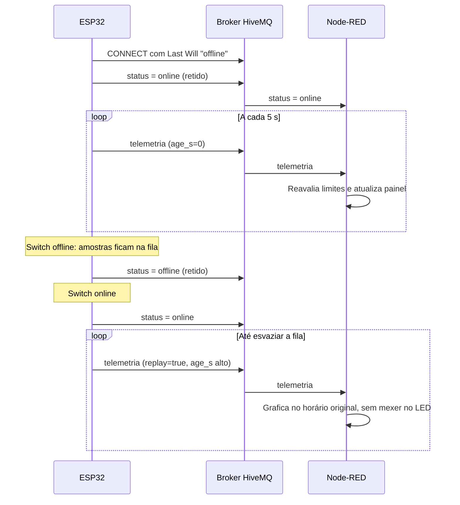

# Relatório da Parte 2: Transmissão para a Nuvem e Visualização (Fog/Cloud Computing)

**CardioIA Conectada, Grupo Zion**

## 1. Visão geral

Esta parte leva as leituras do ESP32 até uma tela em que a equipe de saúde consegue agir. O caminho tem três camadas, cada uma com uma responsabilidade:

| Camada | Componente | Responsabilidade |
|---|---|---|
| **Edge** | ESP32 | Coletar, decidir alertas locais, guardar quando offline, publicar |
| **Cloud** | Broker HiveMQ | Receber e distribuir as mensagens, sem conhecer o conteúdo |
| **Fog** | Node-RED | Validar, reavaliar limites, datar, exibir e vigiar a chegada de dados |

## 2. Fluxo de comunicação MQTT

MQTT é um protocolo de publicação e assinatura feito para dispositivos com poucos recursos e redes instáveis. O ESP32 não sabe quem lê seus dados, e o Node-RED não sabe onde o ESP32 está: os dois falam apenas com o broker. Isso permite acrescentar outro assinante, como um banco de dados ou um Grafana, sem mexer no firmware.

### 2.1 Broker

Usamos o broker público `broker.hivemq.com`, porta 1883. Ele dispensa cadastro e funciona a partir do Wokwi, o que torna a demonstração simples de reproduzir. O preço é que **não há criptografia nem autenticação: qualquer pessoa pode ler estes tópicos.** Só é aceitável aqui porque os dados são sintéticos e o dispositivo usa um pseudônimo. A documentação do Wokwi também avisa que o tráfego do gateway público é monitorado.

Para migrar ao HiveMQ Cloud, basta copiar `firmware/sketch/secrets.exemplo.h` para `secrets.h` e preencher host, usuário e senha, o que ativa TLS na porta 8883. Essa variante compila, mas não foi executada contra um cluster real. Ela usa `setInsecure()`, que criptografa sem validar o certificado; em produção seria preciso validar com `setCACert()`.

### 2.2 Tópicos

| Tópico | Conteúdo | Retido | Publicado por |
|---|---|---|---|
| `cardioia/grupo-zion/wearable-01/telemetria` | JSON de cada amostra | Não | ESP32 |
| `cardioia/grupo-zion/wearable-01/status` | `online` ou `offline` | Sim | ESP32 e broker (Last Will) |

A hierarquia permite assinar um paciente específico ou, com curinga, todos os dispositivos do grupo (`cardioia/grupo-zion/+/telemetria`).

### 2.3 Mensagem

```json
{"dev":"wearable-01","seq":7,"age_s":3,"temp_c":38.6,"umid_pct":55.0,"bpm":72,
 "mov_mg":12,"alertas":["FEBRE"],"replay":false,"fila":2}
```

| Campo | Significado |
|---|---|
| `seq` | Número sequencial; permite perceber lacunas |
| `age_s` | Há quantos segundos a amostra foi capturada; `null` se veio de antes de um reinício |
| `temp_c`, `umid_pct`, `mov_mg` | Valores dos sensores; `null` se o sensor falhou |
| `bpm` | Batimentos por minuto; 0 significa sem sinal |
| `alertas` | Alertas decididos no próprio ESP32 |
| `replay` | `true` se a amostra tem 10 s ou mais, ou seja, é histórico recuperado |
| `fila` | Quantas amostras ainda aguardam envio |

O JSON é montado com `snprintf`, sem biblioteca externa. Um teste confirma que o maior caso possível tem 201 bytes, abaixo do buffer de 256 do sketch e do limite de 320 configurado no cliente MQTT.

### 2.4 Qualidade de serviço e presença

- **Telemetria em QoS 0:** a biblioteca PubSubClient só publica em QoS 0, "no máximo uma vez". O sucesso de `publish()` confirma a escrita local, não a chegada ao broker. Uma queda exatamente nesse instante pode perder a amostra. A correção natural, para uma versão de produto, seria o Node-RED devolver uma confirmação por tópico próprio e o ESP32 só então apagar a amostra.
- **Last Will:** ao conectar, o ESP32 registra no broker a mensagem `offline`. Se ele sumir sem avisar, o próprio broker a publica. Numa desconexão intencional (o switch), o Last Will não dispara, então o firmware publica `offline` antes de sair.
- **Mensagem retida:** o status fica guardado no broker, então um painel recém-aberto já sabe o último estado do dispositivo.

### 2.5 Sequência



## 3. Configuração do dashboard

O dashboard usa `node-red-dashboard` e está em [dashboard/node-red/flows.json](../dashboard/node-red/flows.json). Para rodar: `npm install` e `npm start` nessa pasta, depois abrir `http://localhost:1880/ui`. Para usar em outra instalação, importe o arquivo pelo menu do editor; o broker já vem configurado.

### 3.1 Fluxo

1. Dois nós `mqtt in` assinam a telemetria (JSON) e o status (texto).
2. Uma função **Fog** valida a mensagem, descarta o que estiver malformado, calcula o horário de captura, reavalia os limites e distribui os dados por oito saídas.
3. Uma função mantém os 12 alertas mais recentes para a tabela.
4. Um nó `inject`, a cada 5 s, aciona o **watchdog**.

### 3.2 Painéis exigidos pelo enunciado

| Requisito | Implementação |
|---|---|
| Gráfico de sinal vital | Gráficos de linha de BPM e de temperatura, com janela de 15 minutos |
| Medidor (gauge) | Gauge de temperatura (34 a 42 °C) e de BPM (0 a 200), coloridos nas faixas clínicas |
| Indicador visual de alerta | LED virtual: verde normal, amarelo atenção, vermelho piscante crítico, cinza sem dados |

Os limites escolhidos foram: BPM acima de 120, BPM abaixo de 50 e temperatura acima de 38,0 °C. A imobilidade é tratada como atenção, porque um paciente parado pode estar apenas dormindo.

### 3.3 Decisões que vão além de exibir números

- **Reavaliar na Fog:** o Node-RED não confia só nos alertas do dispositivo, o que dá uma segunda checagem independente.
- **Histórico não acende o LED:** uma taquicardia de duas horas atrás, recuperada do buffer, vai para o gráfico e para a tabela com o horário original e a marca "Recuperado do buffer", mas não dispara o alarme como se fosse agora. Sem isso, cada reconexão pareceria uma emergência.
- **"Não sei" é diferente de "está tudo bem":** sem leitura há 20 s, o LED sai do último estado e mostra **SEM DADOS**. Um painel que congela no verde enquanto o sensor está parado seria perigoso.

## 4. Como foi verificado

O teste ponta a ponta usou o Node-RED real, conectado ao broker público real, recebendo o [simulador Python](../scripts/simula_esp32.py), que publica o mesmo JSON do firmware. O script [capture_evidencias.py](../scripts/capture_evidencias.py) abre o painel em um navegador, confere em cada cenário o estado do LED, o texto esperado e a ausência de painéis sobrepostos, e só então salva o print.

| Cenário | LED esperado | Resultado | Evidência |
|---|---|---|---|
| Sinais normais | Verde | OK | [print](../assets/evidencias/dashboard_01_normal.png) |
| Taquicardia | Vermelho | OK | [print](../assets/evidencias/dashboard_02_taquicardia.png) |
| Febre | Vermelho | OK | [print](../assets/evidencias/dashboard_03_febre.png) |
| Dispositivo offline | Status "Offline" | OK | [print](../assets/evidencias/dashboard_04_offline.png) |
| Reconexão com dados retidos | Verde, com histórico recuperado | OK | [print](../assets/evidencias/dashboard_05_replay.png) |
| Imobilidade | Amarelo | OK | [print](../assets/evidencias/dashboard_06_imobilidade.png) |
| Leituras interrompidas | Cinza, "SEM DADOS" | OK | [print](../assets/evidencias/dashboard_07_sem_dados.png) |

No print de reconexão, parte das amostras retidas aparece como "Tempo real". Isso é esperado: elas tinham menos de 10 s ao chegar, abaixo do limite que define o replay.

**Pendências:** o firmware ainda não foi executado no Wokwi, portanto os prints acima mostram o painel recebendo o simulador, não o ESP32. O tempo de sincronização de uma fila cheia de 4.000 amostras também não foi medido.

## 5. Eficiência, segurança e boas práticas

**O que o projeto já faz:** pseudônimo no lugar de identificação do paciente; dados inteiramente sintéticos; credenciais fora do Git (`secrets.h` e `.env` ignorados); envios limitados por ciclo, para não travar a coleta; JSON de no máximo 201 bytes; validação das mensagens na chegada.

**O que faltaria para um produto real**, considerando que a LGPD trata dado de saúde como dado pessoal sensível:

- TLS com validação de certificado e credencial por dispositivo, com regras de acesso por tópico no broker;
- confirmação de entrega de ponta a ponta;
- autenticação no próprio dashboard, hoje aberto em `localhost`;
- persistência dos dados e trilha de auditoria;
- um sensor cardíaco real e validação clínica dos limites, que aqui são escolhas do grupo.
